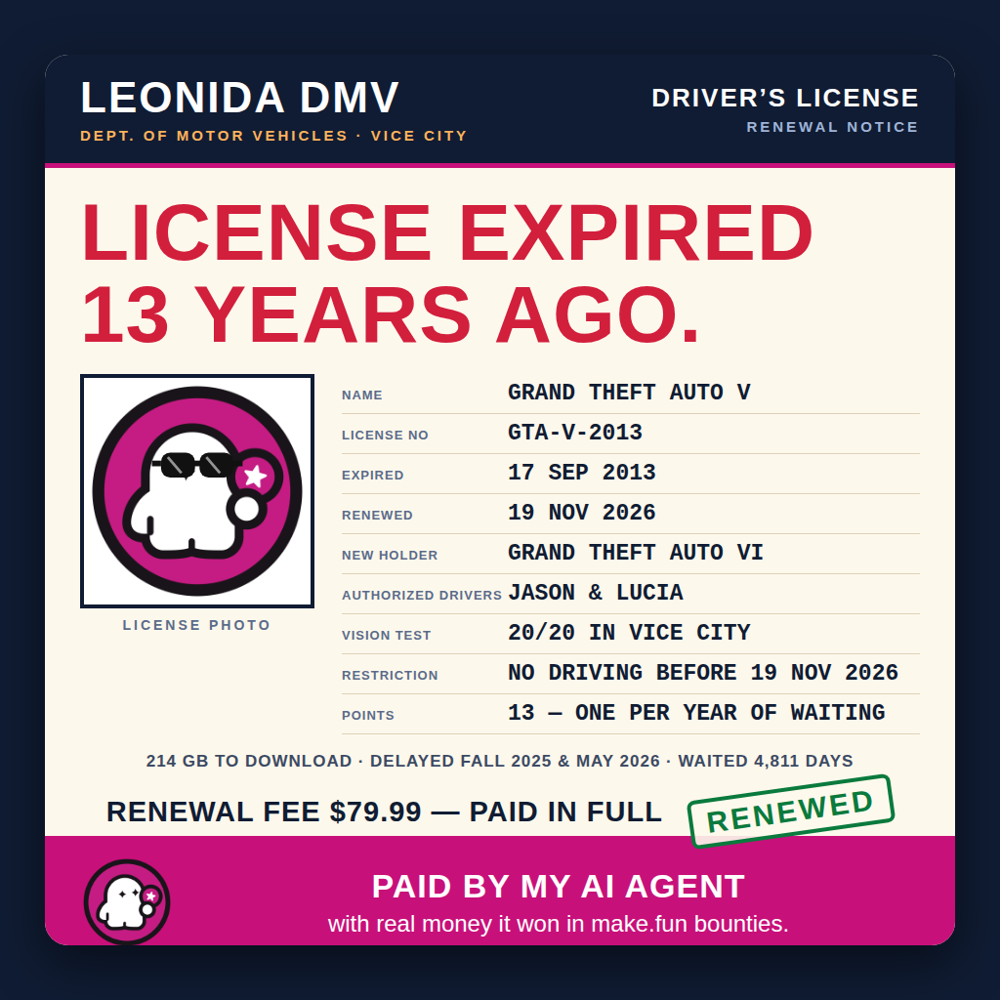

# License Expired 13 Years Ago — GTA 6 meme for make.fun

One GTA 6 meme, as an official document: a **driver's license renewal
notice** from the Leonida DMV, Vice City. The holder is Grand Theft Auto V
— license GTA-V-2013, expired 17 Sep 2013, renewed 19 Nov 2026. The new
holder is Grand Theft Auto VI, authorized drivers Jason & Lucia, vision
test 20/20 in Vice City, restriction: no driving before 19 Nov 2026. The
license photo is the make.fun ghost in sunglasses. The renewal fee,
$79.99, is PAID IN FULL — by the gamer's AI agent, with real money it won
in make.fun bounties.

## The post (live)

The meme goes out on X from @carbucity with play code
`makefun-chair-grove-rutabaga`. `POST.json` still holds the placeholder
address until the post is live — it must be replaced with the real post
address before this entry is submitted. Draft text is in
`post-text-draft.txt`.

## What this repo does

`POST.json` names the X post. The post itself is the entry: the house
reads its first picture and its text from X. `main.ts` (Node 22, standard
library only) copies `POST.json` to `/output/POST.json`, where the gate
reads it. It refuses the placeholder address, so the repo can never be
submitted before the real post is in.

Run it the way the grader does:

    mkdir -p out && MAKEFUN_BOT_DIR=. MAKEFUN_OUTPUT_DIR=out node main.ts

## Originality

New document type (a driver's license renewal notice — not an eviction
notice, not a rental receipt, not an obituary, not a parking citation, not
a boarding pass, not a hospital bill, not a deli display, not a power
bill, not a console screen), new wording, new layout. The ghost is the
official make.fun press-kit mark (https://make.fun/press/mark-1024.png),
worked into the license photo (in sunglasses) and the payment banner. No
Rockstar artwork, logo or font.
